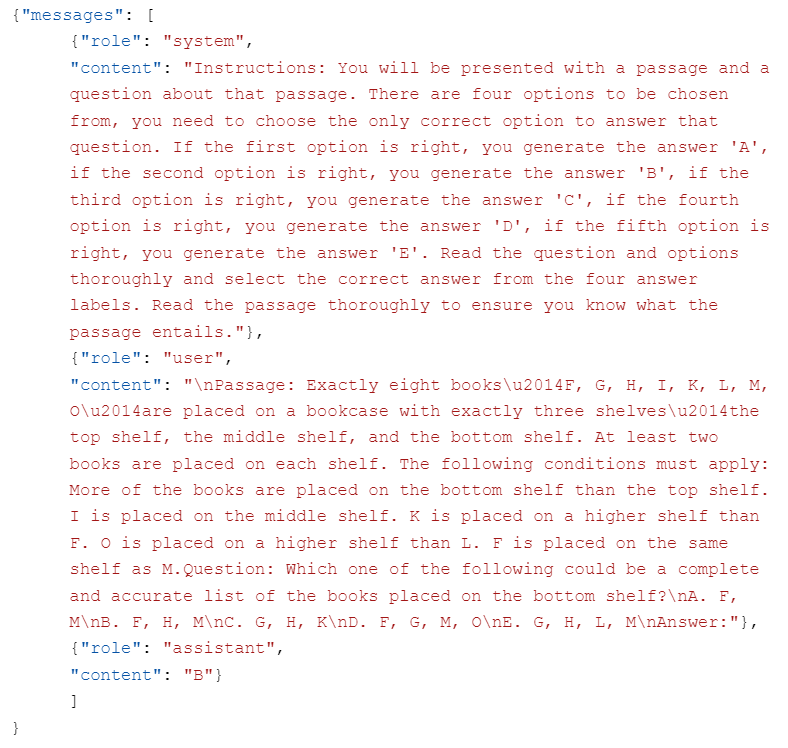
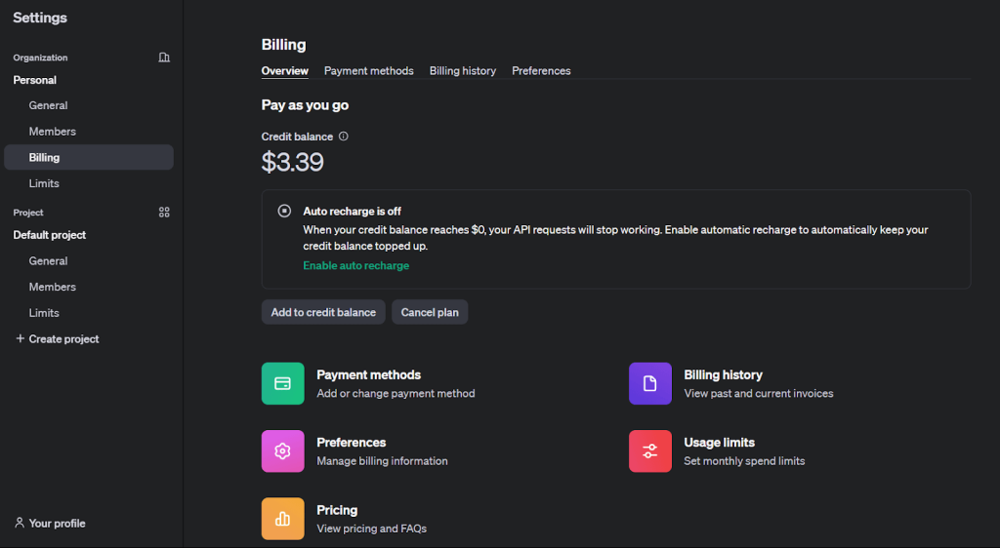
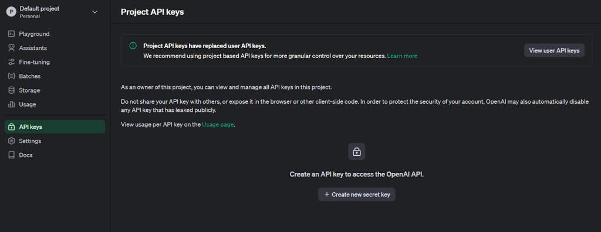
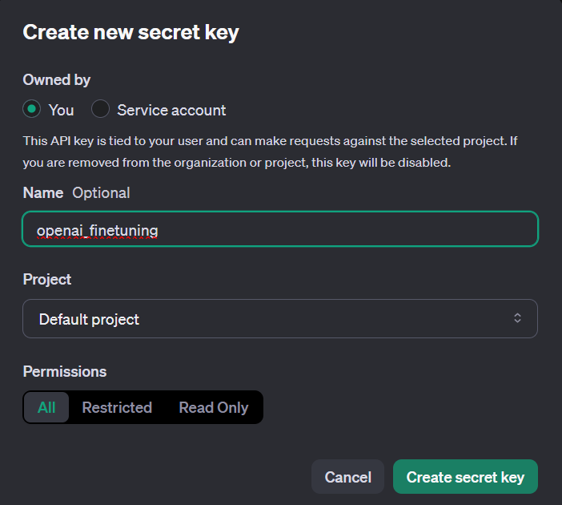
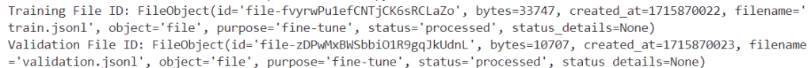
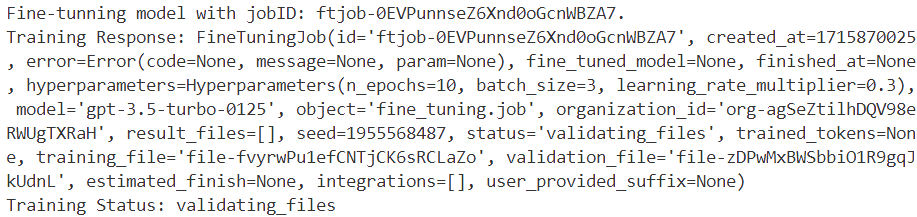
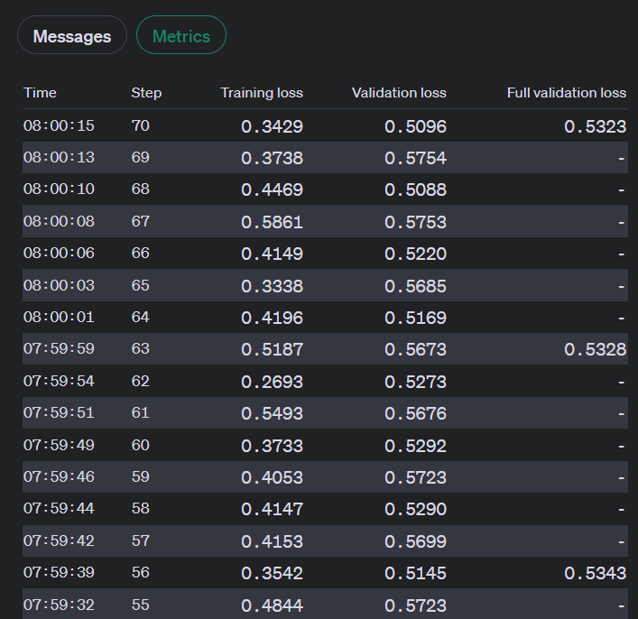
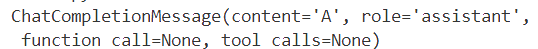
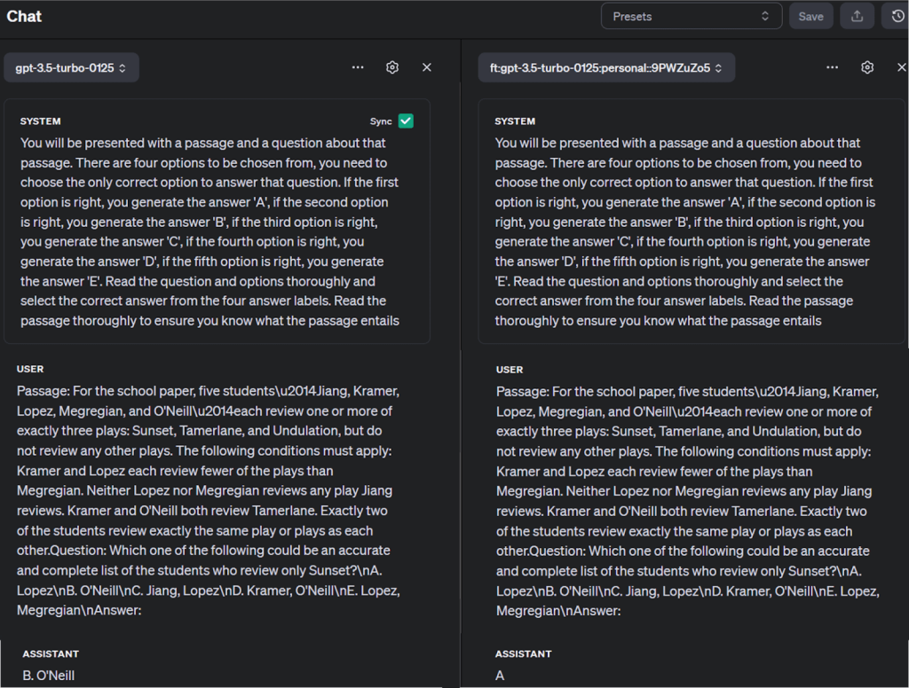

# AI 模型训练指南

[](https://www.bright.cn/)

本指南介绍如何使用 OpenAI 工具集通过微调提升 AI 模型性能：

- [AI 与模型训练简介](#ai-与模型训练简介)
- [微调准备工作](#微调准备工作)
- [分步微调指南](#分步微调指南)
- [成功策略](#成功策略)

## AI 与模型训练简介

AI 系统能够执行学习和推理等类似人类的认知任务。这些模型使用算法根据数据进行预测，而机器学习使其能够通过经验不断改进，无需显式编程。

AI 训练类似于儿童的学习方式：观察模式、进行预测并从错误中学习。模型通过输入数据来识别模式，以便进行未来预测；其性能则通过比较预测结果与已知结果来衡量。

从头创建模型需要在没有先验知识的情况下教授其识别模式，这不仅需要大量资源，而且在数据有限时往往只能获得欠佳的结果。

微调以已经理解一般模式的预训练模型为起点，然后使用专业数据集对其进行训练。这种方法通常能以更少的资源获得更好的结果，因此非常适合专业数据有限的情况。

## 微调准备工作

与从零开始构建模型相比，使用专业数据集进一步训练现有模型似乎更具优势，但成功微调取决于几个关键要素。

### 模型选择策略

选择用于微调的基础模型时，请考虑以下因素：

<strong>任务匹配度：</strong>明确界定你的目标和预期功能。选择在类似任务中表现出色的模型，因为原始用途与目标用途不匹配可能会降低效果。例如，文本生成可能更适合使用 [GPT-3](https://openai.com/index/gpt-3-apps/)，而文本分类使用 [BERT](https://huggingface.co/docs/transformers/en/model_doc/bert) 或 [RoBERTa](https://huggingface.co/docs/transformers/en/model_doc/roberta) 可能效果更好。

<strong>模型大小和复杂度：</strong>在模型能力与资源需求之间找到适当平衡，因为较大的模型能够捕捉更复杂的模式，但也需要更多计算能力。

<strong>评估指标：</strong>选择与你的具体任务相关的性能衡量指标。分类项目可能更重视准确率，而语言生成任务可能更适合使用 [BLEU](https://medium.com/@priyankads/evaluation-metrics-in-natural-language-processing-bleu-dc3cfa8faaa5) 或 [ROUGE](https://medium.com/nlplanet/two-minutes-nlp-learn-the-rouge-metric-by-examples-f179cc285499) 分数。

<strong>社区和资源：</strong>选择拥有强大社区支持和丰富实施资源的模型。优先考虑提供清晰微调指南和可靠预训练检查点的模型。

### 数据获取与处理

数据集的质量和多样性会显著影响微调后模型的性能。请考虑以下关键方面：

<strong>所需数据类型：</strong>所需的数据类型取决于你的具体任务和模型的预训练方式。NLP 任务通常需要来自图书、文章、社交媒体或文字记录等来源的文本。采集方法包括网页爬虫、调查或平台 API。例如，在收集大量多样化的最新数据时，[使用 AI 进行网页爬虫](https://www.bright.cn/blog/web-data/ai-web-scraping) 非常有价值。

<strong>数据清理和标注：</strong>清理包括删除无关内容、处理缺失信息和统一格式。标注则是为数据添加标签，以供模型学习。[Bright Data](/) 等工具可以简化这些关键流程。

<strong>整合多样化数据集：</strong>多样且具有代表性的数据集可确保模型从多个视角学习，从而生成泛化能力更强、更可靠的预测。例如，在微调用于电影评论的情感分析模型时，应纳入来自不同电影类型、题材和情感等级的反馈，以反映现实世界中的分布情况。

### 配置训练环境

确保你拥有适合所选 AI 模型和框架的硬件与软件。大语言模型通常需要强大的计算能力，一般由 GPU 提供。

TensorFlow 或 PyTorch 等框架是训练 AI 模型的常见选择。安装相关库和依赖项可以确保其顺利集成到你的工作流中。例如，微调 OpenAI 开发的模型时可能需要使用 [OpenAI API](https://openai.com/index/openai-api/)。

## 分步微调指南

了解微调基础知识后，让我们探索一个自然语言处理的实际应用。

我们将使用 [OpenAI 微调 API](https://platform.openai.com/docs/guides/fine-tuning) 对预训练模型进行微调。目前，微调支持 gpt-3.5-turbo-0125（推荐）、gpt-3.5-turbo-1106、gpt-3.5-turbo-0613、babbage-002、davinci-002 和实验性的 gpt-4-0613 等模型。GPT-4 微调仍处于实验阶段，符合条件的用户可通过[微调界面](https://platform.openai.com/finetune)申请访问权限。

### 准备数据集

研究[表明](https://arxiv.org/abs/2304.03439)，GPT-3.5 的分析推理能力存在局限。让我们使用 2022 年发布的法学院入学考试分析推理题（AR-LSAT），增强 `gpt-3.5-turbo` 在这方面的能力。该数据集[已公开提供](https://github.com/csitfun/LogiEval/blob/main/Data/ar_lsat.jsonl)。

微调模型的质量直接取决于训练数据。数据集中的每个示例都应遵循 OpenAI 的 [Chat Completions API](https://platform.openai.com/docs/api-reference/chat/create) 对话格式，以消息列表形式包含 role、content 和可选的 name 字段，并存储为 [JSONL](https://jsonlines.org/) 文件。

微调 `gpt-3.5-turbo` 所需的格式如下：

```json
{"messages": [{"role": "system", "content": ""}, {"role": "user", "content": ""}, {"role": "assistant", "content": ""}]}
```

此结构包含一个消息列表，用于构成 `system`、`user` 和 `assistant` 角色之间的对话。`system` 角色的内容定义了微调后系统的行为。

以下是我们的 AR-LSAT 数据集中的一个格式化示例：



需要重点考虑的数据集事项包括：

- OpenAI 要求微调至少使用 10 个示例，并建议为 `gpt-3.5-turbo` 使用 50–100 个示例。最佳数量因使用场景而异。你可以在创建训练文件的同时创建验证文件，以便调整超参数。
- 微调及使用微调后的模型会产生按 token 计费的费用，具体取决于基础模型。详情请参阅 [OpenAI 定价页面](https://openai.com/api/pricing)。
- Token 限制取决于你选择的模型。对于 gpt-3.5-turbo-0125，最大上下文长度为 16,385，因此每个训练示例最多只能包含 16,385 个 token，超出部分将被截断。可使用 OpenAI 的 [token 计数 notebook](https://cookbook.openai.com/examples/How_to_count_tokens_with_tiktoken.ipynb)计算 token 数量。
- OpenAI 提供了一个 [Python 脚本](https://cookbook.openai.com/examples/chat_finetuning_data_prep)，用于识别潜在错误，并验证训练文件和验证文件的格式。

### 设置 API 访问权限

微调 OpenAI 模型需要一个余额充足的 [OpenAI 开发者账户](https://platform.openai.com/docs/overview)。

按照以下步骤设置 API 访问权限：

1. 在 [OpenAI 网站](https://platform.openai.com/overview)上创建账户。

2. 在“Settings”下的“Billing”部分为账户充值，以启用微调。



3. 点击左上角的个人资料图标，然后选择“API Keys”，进入密钥创建页面。



4. 输入描述性名称，生成新的密钥。



5. 安装 OpenAI Python 库以使用微调功能。

```sh
pip install openai
```

6. 将 API 密钥配置为环境变量，以建立通信。

```python
import os
from openai import OpenAI

# Set the OPENAI_API_KEY environment variable
os.environ['OPENAI_API_KEY'] = 'The key generated in step 4'
client = OpenAI(api_key=os.environ['OPENAI_API_KEY'])
```

### 上传训练材料

验证数据后，使用 [Files API](https://platform.openai.com/docs/api-reference/files/create) 上传文件，以用于微调作业。

```python
training_file_id = client.files.create(
  file=open(training_file_name, "rb"),
  purpose="fine-tune"
)
validation_file_id = client.files.create(
  file=open(validation_file_name, "rb"),
  purpose="fine-tune"
)
print(f"Training File ID: {training_file_id}")
print(f"Validation File ID: {validation_file_id}")
```

成功执行后，你将获得训练数据集和验证数据集各自的唯一标识符。



### 启动微调会话

上传文件后，通过[用户界面](https://platform.openai.com/finetune)或以编程方式创建微调作业。

以下是使用 OpenAI SDK 启动微调作业的方法：

```python
response = client.fine_tuning.jobs.create(
  training_file=training_file_id.id,
  validation_file=validation_file_id.id,
  model="gpt-3.5-turbo",
  hyperparameters={
    "n_epochs": 10,
    "batch_size": 3,
    "learning_rate_multiplier": 0.3
  }
)
job_id = response.id
status = response.status

print(f'Fine-tunning model with jobID: {job_id}.')
print(f"Training Response: {response}")
print(f"Training Status: {status}")
```

- `model`：指定要微调的模型（`gpt-3.5-turbo`、`babbage-002`、`davinci-002` 或现有的微调模型）。
- `training_file` 和 `validation_file`：上传时返回的文件标识符。
- `n_epochs`、`batch_size` 和 `learning_rate_multiplier`：可自定义的训练参数。

如需了解其他微调选项，请参阅 [API 文档](https://platform.openai.com/docs/api-reference/fine-tuning/create)。

此代码会生成作业 ID `ftjob-0EVPunnseZ6Xnd0oGcnWBZA7` 的相关信息：



微调作业可能需要较长时间才能完成，因为它们需要排队等待其他作业。训练时间取决于模型复杂度和数据集大小，可能从几分钟到数小时不等。

完成后，你将收到 OpenAI 发送的确认邮件。

通过微调界面监控作业状态。

### 评估模型性能

OpenAI 会在训练期间计算多项关键指标：

- 训练损失
- 训练 token 准确率
- 验证损失
- 验证 token 准确率

验证指标通过两种方式计算：每一步基于小批量数据计算，以及每个 epoch 结束后基于完整验证集计算。完整验证指标能够提供最准确的性能指示，并验证训练过程是否顺利（损失应下降，而 token 准确率应上升）。

在微调进行期间，可通过以下方式查看这些指标：

**1. 用户界面：**



**2. API：**

```python
import os
from openai import OpenAI

client = OpenAI(api_key=os.environ['OPENAI_API_KEY'],)
jobid = 'jobid you want to monitor'

print(f"Streaming events for the fine-tuning job: {jobid}")

# signal.signal(signal.SIGINT, signal_handler)

events = client.fine_tuning.jobs.list_events(fine_tuning_job_id=jobid)
try:
    for event in events:
        print(
            f'{event.data}'
        )
except Exception:
    print("Stream interrupted (client disconnected).")
```

此代码会输出流式事件，包括步骤编号、训练和验证损失值、总步骤数，以及训练集和验证集的平均 token 准确率：

```
Streaming events for the fine-tuning job: ftjob-0EVPunnseZ6Xnd0oGcnWBZA7
{'step': 67, 'train_loss': 0.30375099182128906, 'valid_loss': 0.49169286092122394, 'total_steps': 67, 'train_mean_token_accuracy': 0.8333333134651184, 'valid_mean_token_accuracy': 0.8888888888888888}
```

### 优化结果

如果微调结果未达到预期，请考虑以下改进策略：

**1. 优化数据集：**

- 添加针对模型特定弱点的示例，并确保响应分布与预期模式一致。
- 检查是否存在可复现的数据问题，并确认示例包含生成正确响应所需的全部信息。
- 确保多位贡献者提供的数据保持一致，并统一所有示例的格式，使其符合推理阶段的预期。
- 请记住，高质量数据通常优于数量更多但质量较低的数据。

**2. 调整参数：**

- OpenAI 允许自定义三个关键超参数：epoch 数量、学习率倍数和批次大小。
- 首先使用内置函数根据数据集特征选择的默认值，然后按需调整。
- 如果模型未能充分遵循训练模式，请增加 epoch 数量。
- 如果模型响应缺乏多样性，请将 epoch 数量减少 1–2 个。
- 如果出现收敛问题，请提高学习率倍数。

### 使用检查点模型

OpenAI 目前允许访问每个微调作业最后三个 epoch 的检查点。这些检查点是完整模型，可用于推理和进一步微调。

要访问检查点，请等待作业完成，然后使用微调作业 ID [查询检查点端点](https://platform.openai.com/docs/api-reference/fine-tuning/list-checkpoints)。每个检查点都包含一个 `fine_tuned_model_checkpoint` 字段，其中存有模型检查点名称。你也可以通过用户界面获取检查点名称。

使用 [**openai.chat.completions.create()**](https://platform.openai.com/docs/api-reference/chat) 函数提交包含提示词和模型名称的查询，以测试检查点模型的性能：

```python
completion = client.chat.completions.create(
  model="ft:gpt-3.5-turbo-0125:personal::9PWZuZo5",
  messages=[
    {"role": "system", "content": "Instructions: You will be presented with a passage and a question about that passage. There are four options to be chosen from, you need to choose the only correct option to answer that question. If the first option is right, you generate the answer 'A', if the second option is right, you generate the answer 'B', if the third option is right, you generate the answer 'C', if the fourth option is right, you generate the answer 'D', if the fifth option is right, you generate the answer 'E'. Read the question and options thoroughly and select the correct answer from the four answer labels. Read the passage thoroughly to ensure you know what the passage entails"},
    {"role": "user", "content": "Passage: For the school paper, five students\u2014Jiang, Kramer, Lopez, Megregian, and O'Neill\u2014each review one or more of exactly three plays: Sunset, Tamerlane, and Undulation, but do not review any other plays. The following conditions must apply: Kramer and Lopez each review fewer of the plays than Megregian. Neither Lopez nor Megregian reviews any play Jiang reviews. Kramer and O'Neill both review Tamerlane. Exactly two of the students review exactly the same play or plays as each other.Question: Which one of the following could be an accurate and complete list of the students who review only Sunset?\nA. Lopez\nB. O'Neill\nC. Jiang, Lopez\nD. Kramer, O'Neill\nE. Lopez, Megregian\nAnswer:"}
  ]
)
print(completion.choices[0].message)
```

answer 字典中的响应：



你还可以在 [OpenAI Playground](https://platform.openai.com/playground/) 中将微调模型与其他模型进行比较：



## 成功策略

为实现有效微调，请考虑以下建议：

<strong>数据质量：</strong>确保专业数据干净、多样且具有代表性，以防止过拟合，即模型在训练数据上表现良好，但在新输入上的表现较差。

<strong>参数选择：</strong>选择适当的超参数，以避免收敛缓慢或结果欠佳。虽然此步骤复杂且耗时，但对于有效训练至关重要。

<strong>资源规划：</strong>请注意，微调大型模型需要大量计算能力和充足的时间。

### 常见挑战

<strong>平衡复杂度：</strong>在模型复杂度与训练时长之间找到适当平衡，以防止过拟合（方差过大）和欠拟合（偏差过大）。

<strong>知识保留：</strong>在微调过程中，模型可能会丢失之前获得的通用知识。定期测试模型在不同任务上的表现，以缓解此问题。

<strong>领域适配：</strong>当微调数据与预训练数据存在显著差异时，可能会出现领域偏移问题。采用领域适配技术来弥合这些差距。

### 模型保存

训练完成后，保存模型的完整状态以供将来使用，包括模型参数和优化器状态。这样以后就能从同一位置恢复训练。

### 伦理影响

<strong>偏见问题：</strong>预训练模型可能包含固有偏见，而微调可能会放大这些偏见。如果无偏预测至关重要，请选择经过公平性测试的预训练模型。

<strong>输出验证：</strong>微调后的模型可能生成看似可信但实际上错误的信息。请实施可靠的验证系统来处理此类情况。

<strong>性能下降：</strong>由于环境或数据分布发生变化，模型性能可能随时间下降。请定期监控性能，并根据需要重新进行微调。

### 前沿技术

针对 LLM 的高级微调方法包括低秩适配（LoRA）和量化低秩适配（QLoRA），它们可以在保持性能的同时降低计算与资金需求。参数高效微调（PEFT）通过调整极少量参数来高效适配模型。DeepSpeed 和 ZeRO 可优化大规模训练的内存使用。这些技术能够应对过拟合、知识丢失和领域适配等挑战，提高 LLM 微调的效率和效果。

除微调外，还可以探索迁移学习和强化学习等其他高级训练方法。迁移学习将知识从[一个领域应用于相关问题](https://www.bright.cn/blog/web-data/data-pitfalls-when-developing-ai-models)，而强化学习则使智能体能够通过与环境交互并最大化奖励，学习最优决策方式。

如需深入探索 AI 模型训练，请参考以下宝贵资源：

- [Ashish Vaswani 等人撰写的《Attention Is All You Need》](https://arxiv.org/abs/1706.03762)
- [Ian Goodfellow、Yoshua Bengio 和 Aaron Courville 合著的《Deep Learning》](https://www.deeplearningbook.org/)
- [Daniel Jurafsky 和 James H. Martin 合著的《Speech and Language Processing》](https://web.stanford.edu/~jurafsky/slp3/ed3book.pdf)
- [训练 LLM 的不同方法](https://towardsdatascience.com/different-ways-of-training-llms-c57885f388ed)
- [掌握 LLM 技术：训练](https://developer.nvidia.com/blog/mastering-llm-techniques-training/)
- [Hugging Face 的 NLP 课程](https://huggingface.co/learn/nlp-course/chapter1/1)

## 总结

开发有效的 AI 模型需要大量高质量数据。虽然定义问题、选择模型和迭代优化都至关重要，但真正决定差异的是数据的质量和数量。

与其自行创建和维护网页爬虫工具，不如使用 Bright Data 平台提供的预构建数据集或[自定义数据集](https://www.bright.cn/products/datasets)，简化数据采集。

立即注册并开始免费试用！
